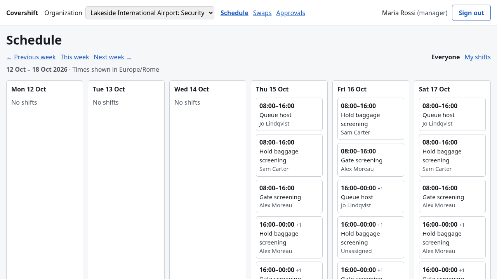

# Phase 2 report

- **Scope:** CI and dependency housekeeping; the API endpoints the frontend needs; the React
  frontend (auth, org switcher, week schedule, swap flow, manager approvals) with component
  and end-to-end tests in CI.
- **State at the end of phase 2:** 10 PRs merged (#11–#21; #13 was the throwaway gate
  proof), every one through the `CI gate`. Tests: 36 shared, 59 API unit, 196 API
  integration/e2e, 84 web component, 14 Playwright e2e. The e2e suite runs on the real stack
  under the production CSP, with axe (WCAG 2.1 AA).

## Done

**Delivery and CI** (#11, #12, #14–#16, #20)

- A single required check, **`CI gate`**. It needs every blocking job, runs with
  `if: always()`, and fails unless each one concluded `success`, so a skipped or cancelled
  job can't satisfy it. The ruleset requires only the gate plus the CodeQL code-scanning
  rule. A throwaway PR (#13) showed the merge being refused.
- gitleaks and the blocking audit moved into `ci.yml`. The database lint runs inside the
  integration job, so it reuses that job's stack. `security.yml` keeps CodeQL and a weekly
  audit.
- Dependabot: `@nestjs/*` arrives as one grouped PR, and `@types/node` majors track `.nvmrc`.
  The first version didn't work (see "What I'd do differently"); #14 fixed it.
- **Nest 12** (#15), after a spike on the production build: it boots, `/docs-json` is
  identical, and the same crafted requests get identical answers. `nestjs-zod` still declares
  Nest 11 as its peer, so the exception is explicit and scoped in `pnpm-workspace.yaml`. A
  side effect: the `js-yaml` advisory is gone.
- A **pre-commit hook** (simple-git-hooks): ESLint and Prettier on staged files, plus a
  typecheck of the packages they touch.

**API for the frontend** (#17, #19)

- `GET /me`, `/organizations`, `/organizations/:id/positions` and `/members`. Members lists
  only active members. An unknown or hidden org is 404, and that answer requires an active
  membership on top of organizations RLS, so each layer fails closed on its own.
- Keyset pagination for shifts and swap requests. The cursor holds the database's own UTC
  key, with microseconds, plus the row id. It is correct for keys that differ by less than a
  millisecond and for identical `now()` timestamps. Each service writes its keyset predicate
  as literal SQL, so the interpolation lint rule still checks it.
- **One error envelope** on every path, with a required `code`: guard, id parsing,
  body-parser, unknown routes and unexpected failures included. A body over 100 kB used to
  return 500; it now returns 413. The OpenAPI document lists each endpoint's real error
  responses, and it is committed as `docs/openapi.json` with a drift test.
- Positions and members are hard-capped at 500.
- `organizations.timezone` is validated by a trigger against `pg_timezone_names`. The shared
  contract checks only the shape of the name, and a test asserts that every zone the
  database accepts also passes the contract.
- Public signup is disabled. A test also covers the opposite misconfiguration: if the email
  provider were disabled, password logins would break.

**Web app** (#18, #21)

- React 19, Vite, TypeScript (strict), React Router, TanStack Query, react-hook-form with the
  shared zod contracts. Supabase is used for authentication only.
- **Same-origin API under `/api`**, so the API needs no CORS policy.
- **Session handling.**
  - The session lives in `localStorage`.
  - Refresh is single-flight: concurrent 401s share one `refreshSession()` call.
  - When a refresh fails, the app returns to login and says why.
  - `returnTo` accepts same-origin paths only.
- **The org lives in the URL**, validated against `/me`. The org switcher keeps the current
  section.
- **Schedule:** weeks run Monday to Monday in the org's timezone and are DST-safe. The page
  shows a visible warning at the safety cap and a visible note when it falls back to UTC.
- **Swaps:** offer (direct or open), offers to me, open offers to claim, and my requests.
  **Approvals** hide approve and reject when the manager is part of the swap. Every write
  refetches the data. A 403 also refetches `/me`, so a revoked role turns the page read-only
  while the API's reason stays on screen.
- **Error mapping:** every shared error code has copy, enforced by a total `Record`. 409 and
  422 responses show the API's reason verbatim.
- **CSP and security headers** in `security-headers.ts`, served by `vite preview`. No inline
  scripts or styles, no `eval`, `connect-src` limited to self and Supabase,
  `frame-ancestors 'none'`. Every e2e test fails on any violation.

**Proof**

- Negative controls for every new security-relevant test. Each was applied to the committed
  tree and reverted with `git apply -R`, never with `git checkout`, and RLS state was
  verified afterwards. Highlights:
  - RLS disabled per table, one table at a time and two layers at a time.
  - Each table denies a deactivated member through its own policy.
  - Millisecond cursors, and keysets without the id tiebreaker.
  - No CSP header, and zod's eval probe left on.
  - The pre-fix `returnTo`: the browser really left the app.
  - A refresh that isn't single-flight, and mocks that aren't schema-validated.
  - No `/me` refetch after a 403, caught by both the component test and the e2e.
  - Public signup re-enabled.
- MSW mocks are parsed with the shared schemas, and unhandled requests fail the test.
- The Playwright e2e covers a full swap across three users in three browser contexts, and a
  role revoked while the inbox is open (403 → reason → read-only, swap unchanged).

**Security findings, fixed under the standing rule**

- **Open redirect in `returnTo`.** URL normalization turned `/.//evil.example` into
  `//evil.example` after the check had already passed. The fix validates the normalized
  result. There are regression tests, and the old code fails the e2e.
- **Oversized request body returned 500** instead of a coded 413 (#17).

## Fragile

1. **The e2e suite shares one seeded database and runs serially.** Global setup reseeds the
   demo org on each run, and tests that change roles or swaps restore what they touched in a
   `finally`. A test killed mid-run (e.g. by a timeout) can leave a revoked role behind until
   the next run's seed.
2. **Seed dates are relative to "tomorrow"** (UTC). The e2e and screenshot scripts compute
   days the same way, so the screenshots change week to week by design.
3. **`localStorage` session.** The CSP is the XSS mitigation, and there is no
   `report-uri`/`report-to` endpoint yet, so in production a violation would go unnoticed.
   Phase 4 should add reporting.
4. **Positions and members are capped at 500 with no client-side signal.** The API logs a
   warning, but a 501st member would show up as "Former member" in names. Paginate both
   before an organization gets that large.
5. **Swap cards fetch their shift one by one** (`GET /shifts/:id` per card). That is fine at
   20 per page but is an N+1 pattern; an embedded shift summary in the swap response is the
   fix.
6. **Role changes reach the UI only through `/me`** (5-minute stale time) or after a 403.
   The API is always right; the UI can briefly offer an action the API will refuse.
7. **zod runs jitless because the first import says so** (`src/zod-jitless.ts`). If the
   import order changes, the CSP guard catches it in e2e, not at build time.
8. **Nest 12 on an undeclared `nestjs-zod` peer.** Verified on the production build;
   remove the exception when nestjs-zod#471 ships.
9. **Timezone data differs between the database and browsers.** The contract checks shape
   only, and the UI falls back to UTC visibly.
10. **Only Chromium is tested e2e.** The native `<dialog>` modality is exercised there only;
    jsdom uses a minimal polyfill.
11. **The pre-commit hook reads the working tree, not the index.** A partially staged file is
    checked as it is on disk. The CI gate is the backstop.
12. **Supabase CLI configuration has traps.** `[auth.email] enable_signup = false` disables
    every email login. Hosted environments keep their own settings, so phase 4 must verify
    them.
13. **Still open from phase 1:** the certificate `FOR SHARE` race, overlap checked only per
    organization, `issued_at` ignored by eligibility, and maintenance roles bypassing the swap
    triggers (the new timezone trigger deliberately doesn't exempt them).

## What I'd do differently

- **Assert every scripted edit.** Twice, a scripted text replacement silently didn't match
  after Prettier had reformatted the code. Tests caught both, but a no-op edit should never
  get that far.
- **Chain with `&&`, never `;`.** One commit landed with a failing typecheck because the
  commit ran after a failing step. The pre-commit hook now makes that impossible locally.
- **Typecheck before trusting a green test run.** MSW 3 renamed `onUnhandledRequest`; the old
  key was silently ignored, so unmocked requests only warned. Typecheck found it, the tests
  didn't.
- **Validate what you return, not what you received.** The `returnTo` open redirect was a
  check-then-normalize bug.
- **Verify configuration against the running service.** `enable_signup = false` in the wrong
  section broke every login. The first test only asserted that signup was refused, not that
  login still worked.
- **Read the tool's logs instead of its documentation-shaped assumptions.** Dependabot picks
  the _most specific_ group, not the first one listed; a green run with nothing opened was
  the clue. The first ruleset update was partial and only the API read-back showed it.
- **Don't assume which organization is "first".** An e2e fixture added a second org whose
  name sorted earlier, and the default landing page changed.

## Backlog

**Phase 4 (next, before phase 3): deploy.** A separate proposal; it includes the deferred
items below.

- Route-level code-splitting for the web bundle (one chunk: ~730 kB, ~215 kB gzipped).
- Hosted Supabase auth settings, configured and verified per environment: signup off, email
  provider on, JWT expiry, refresh-token rotation, redirect URLs.
- Reuse `apps/web/security-headers.ts` for the hosted CSP, plus HSTS,
  `upgrade-insecure-requests` and a CSP reporting endpoint.
- Rate limiting on the API before the demo is public.

**Phase 3 (product)**

- **A swap history view for managers** (approved, rejected, declined, cancelled), with
  filters.
- Admin-only membership, position and certification management (ADR 001); invitations to
  replace seeded accounts.
- A soft "cancelled" shift status instead of `DELETE`.
- Eligibility that respects `issued_at`, and the certificate `FOR SHARE` fix once
  certificates are editable.
- Pagination for members and positions; embedded shift summaries in swap responses.

**Engineering**

- Integration tests in parallel, with one database per worker (template databases).
- E2E in Firefox and WebKit.
- Caching the Supabase Docker images in CI (both stack startups are about 40 s each).

## Codex reviews

### #21 (swap screens), `/codex:review --base main`

**Finding (P1):** `apps/web/e2e/fixtures.ts:68`: contexts created with `browser.newContext()`
don't inherit `use.baseURL`, so `page.goto('/login')` in `as(email)` would fail and the
swap-flow, stale-role and deep-link tests couldn't run.

**Outcome: false positive, hardened anyway.**

- _Mechanism._ Inside a test, `@playwright/test` 1.64 registers a `runBeforeCreateBrowserContext`
  instrumentation hook (`playwright/lib/index.js`, lines 122–126) that copies every configured
  context option (`_combinedContextOptions`, which includes `use.baseURL`, lines 290 and 343–344)
  into any browser context created during the test, unless the caller set that key. That
  covers `browser.newContext()` from test code. The finding holds for the plain `playwright`
  library, not for the test runner.
- _Evidence the tests ran._ CI run 38630599423 (head `07bcf16`), E2E job: 14 tests,
  0 skipped. The deep-link test took 566 ms, stale-role 699 ms, and full swap 3.2 s. Earlier
  negative controls (no `/me` refetch after a 403, Approve wired to reject) made these tests
  fail at assertions _after_ sign-in, deep into the flows, which couldn't happen if
  navigation threw.
- _Change._ The fixture now passes `baseURL` explicitly and throws if it's unset, so it
  doesn't depend on runner-internal behavior or on being called inside a test.
